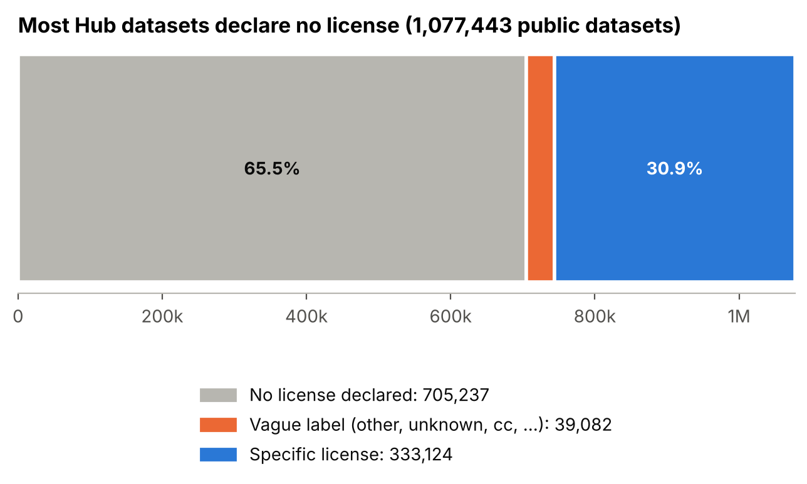
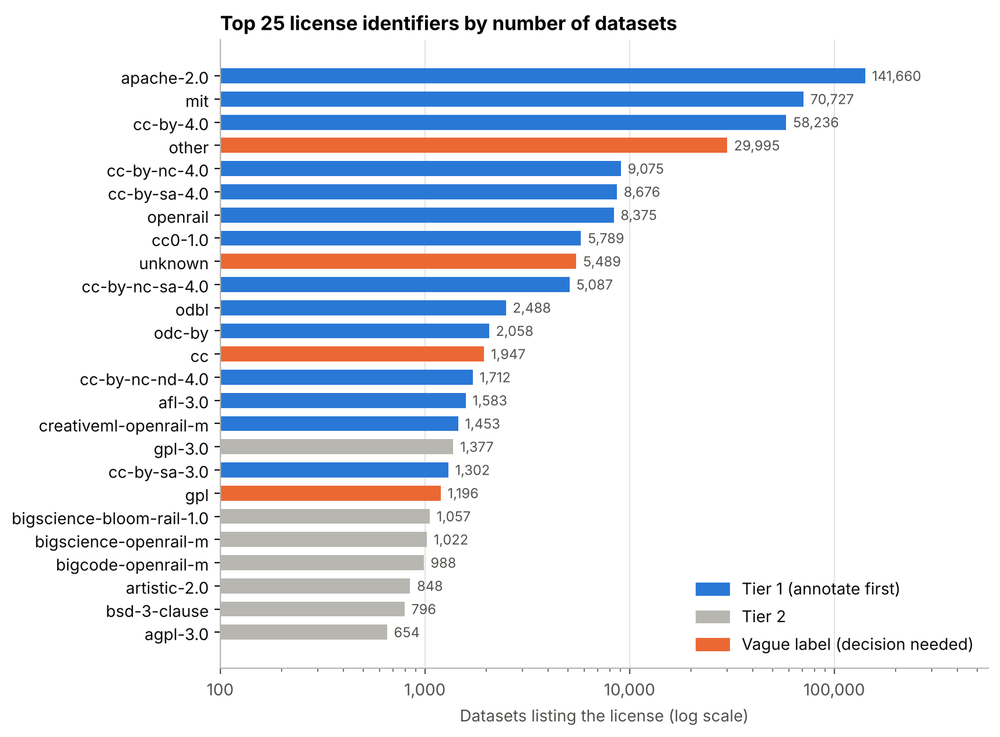
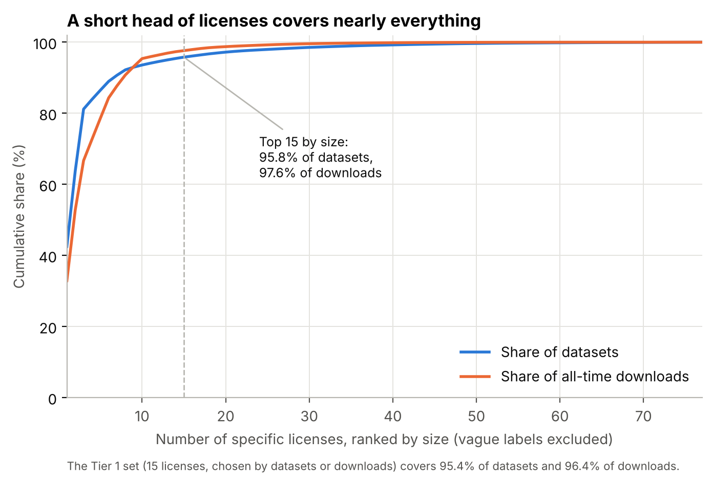
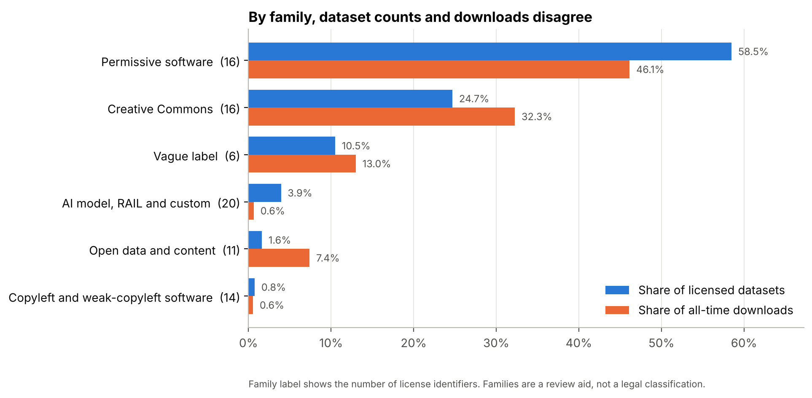
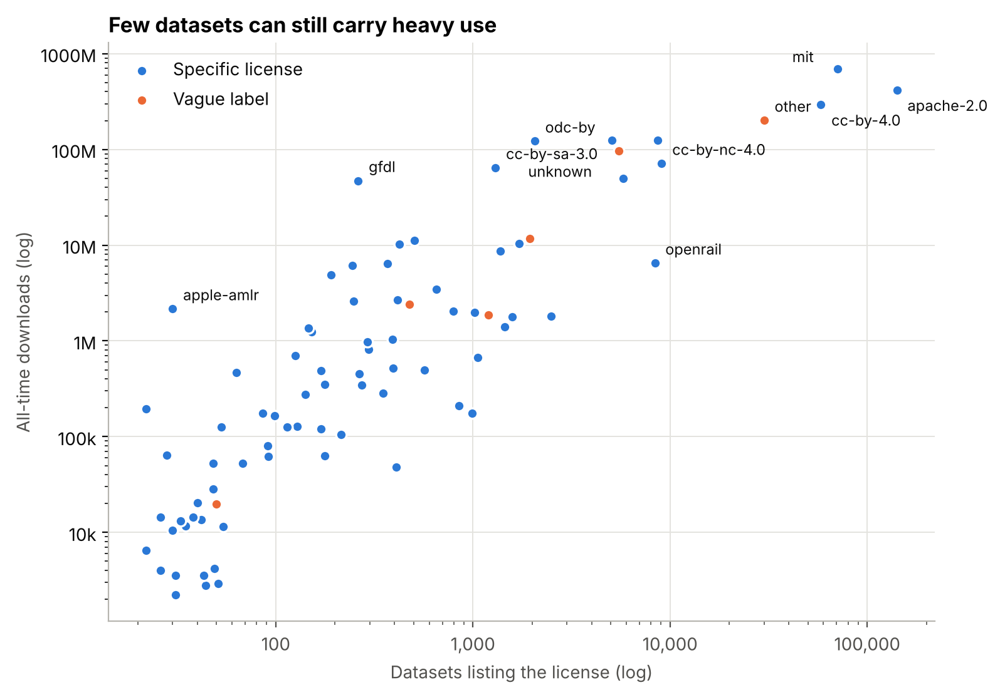
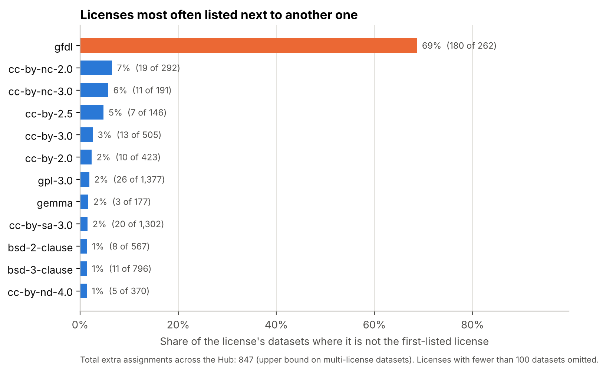

# Hugging Face license census

Census of the license tags on all 1,077,443 public Hugging Face datasets
(crawl of 5 October 2026), prepared during the COST GOBLIN (CA23147) short-term
scientific mission at IDLab, Ghent University. It gives the target list for the
gold-standard annotation of licenses as ODRL policies.

- Report: [report_huggingface_licenses.MD](../report_huggingface_licenses.MD)
- Per-license counts: [hf_license_stats.csv](../hf_license_stats.csv)

**Headline numbers.** 705,237 datasets (65%) declare no license. The other
372,206 use 83 distinct identifiers (77 specific licenses, 6 vague labels such as
`other`). Fifteen licenses (Tier 1) cover 95% of the datasets with a specific
license and 96% of their downloads. Licenses are the tags authors declared,
not verified ones.

## Figures

## Data

- Crawl script: [`scripts/crawl_hf_licenses.py`](../../scripts/crawl_hf_licenses.py) (`huggingface_hub`, about 9.5 minutes for the full Hub)
- Per-dataset records (gzipped JSONL, 1,077,443 lines): attached to the [census release](../../releases/tag/census-2026-10-05)
- SHA-256: `df4bef3d1a2375004efa8c262ebe99fbfc65fe7cf94f1a37862fc76cf2477593`
